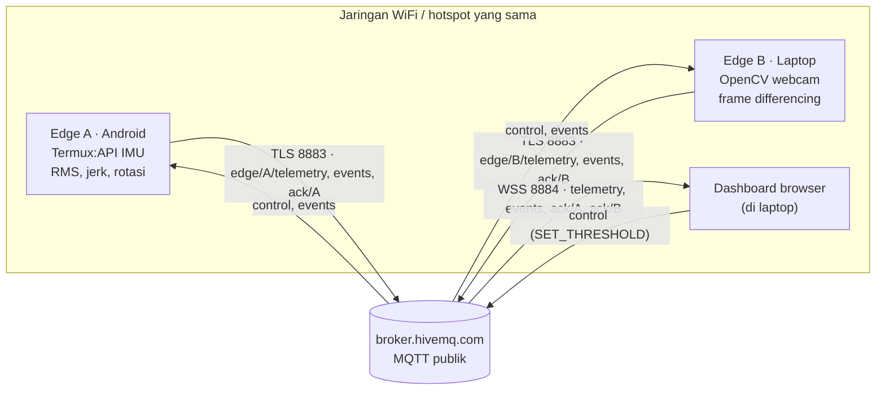

# RoadSense Lab

Prototipe IoT dua edge untuk memantau pola getaran dan konteks gerak visual dalam simulasi di atas meja. Sistem terdiri dari satu ponsel Android dan satu laptop dengan webcam, yang terhubung ke broker MQTT cloud.

> **Batasan penting.** Prototipe ini **belum dapat memvalidasi kerusakan jalan secara langsung**. Edge A (ponsel) hanya menandai pola getaran, sedangkan edge B (webcam laptop) hanya memberi konteks gerak visual. Sistem ini tidak memiliki GPS, sehingga tidak ada informasi lokasi maupun peringatan berbasis lokasi. Seluruh pengujian dirancang untuk simulasi meja yang terkendali, bukan untuk pengujian di jalan.

Spesifikasi teknis lengkap (algoritma, kontrak MQTT, payload JSON) tersedia di [`SPEC.md`](SPEC.md).

## Ringkasan sistem

| | Edge A — ponsel Android | Edge B — laptop |
|---|---|---|
| Sensor | Accelerometer + gyroscope melalui Termux:API | Webcam melalui OpenCV |
| Pemrosesan di edge | Vibration RMS, peak jerk, rotation RMS | Frame differencing grayscale, rata-rata per jendela 1 detik |
| Status | `NORMAL`, `BUMP_SUSPECTED`, `DEVICE_MOVEMENT`, `SENSOR_ERROR` | `NORMAL`, `MOTION_OBSERVED` |
| Program | `python -m edge_phone.main` | `edge_laptop/camera_edge.py` |

- Tiga jenis sensor: accelerometer, gyroscope, dan webcam.
- Dua metode pemrosesan: analisis getaran IMU (RMS dan jerk) dan frame differencing webcam.
- Komunikasi dua arah melalui MQTT over TLS: telemetri dan event dari edge, perintah `SET_THRESHOLD` dari dashboard, lalu ACK dari edge.
- Dashboard browser memantau kedua edge dan mengirim perintah ambang. Dashboard tidak dihitung sebagai edge.

## Arsitektur



Semua topic berada di bawah `roadsense/{PROJECT_ID}/`. Setiap perangkat terhubung langsung ke broker; tidak ada komunikasi langsung antar-perangkat di jaringan lokal.

## Struktur repository

```
.
├── SPEC.md                    # spesifikasi teknis dan kontrak MQTT
├── README.md
├── edge_phone/                # Edge A (paket Python, dijalankan di Termux)
│   ├── main.py                # entry point CLI
│   ├── config.py              # konfigurasi & variabel lingkungan
│   ├── sensors.py             # penemuan sensor & stream termux-sensor
│   ├── processor.py           # perhitungan & klasifikasi
│   ├── mqtt_client.py         # MQTT, kontrol, ACK
│   └── requirements.txt
├── edge_laptop/               # Edge B
│   ├── camera_edge.py
│   └── requirements.txt
├── dashboard/                 # index.html, style.css, app.js (statis, tanpa build)
├── tools/
│   ├── monitor.py             # memantau telemetry, events, dan ACK dari terminal
│   └── send_control.py        # mengirim SET_THRESHOLD dari terminal
├── tests/
│   └── test_edge_phone.py     # unit test edge A (unittest)
└── docs/
    ├── ppt_outline.md
    ├── demo_script.md
    ├── test_scenarios.md
    └── screenshots/
```

## Status implementasi dan pengujian

| Fitur | Diimplementasikan | Diuji otomatis | Butuh uji fisik |
|---|---|---|---|
| Penemuan sensor accelerometer/gyroscope (`termux-sensor -l`) | ✓ | ✓ dengan mock | ✓ |
| Vibration RMS, peak jerk, rotation RMS | ✓ | ✓ dengan data sintetis | ✓ |
| Klasifikasi status & cooldown event edge A | ✓ | ✓ | ✓ |
| Kontrol `SET_THRESHOLD` dan ACK edge A | ✓ | ✓ (fungsi parser) | ✓ melalui broker |
| Nama topic edge A | ✓ | ✓ | — |
| Frame differencing dan klasifikasi edge B | ✓ | — | ✓ |
| Kontrol dan ACK edge B | ✓ | — | ✓ |
| Koneksi MQTT/TLS ke HiveMQ (A, B, tools) | ✓ | — | ✓ |
| Dashboard (koneksi WSS, validasi, grafik, kontrol, ACK) | ✓ | — | ✓ |
| Event lintas perangkat (A → log B, B → log A) | ✓ | — | ✓ |
| Reconnect otomatis setelah koneksi terputus | mengandalkan paho-mqtt / MQTT.js | — | ✓ |

Hasil yang sudah terverifikasi:
- 10 unit test di `tests/test_edge_phone.py` lulus (`python -m unittest discover -s tests -v`) pada Python 3.13 di Linux, yaitu mesin review dan **bukan** perangkat Android.
- Opsi `--help` pada keempat program Python berjalan tanpa galat.
- `dashboard/app.js` lolos pemeriksaan sintaks `node --check`.

Belum ada hasil pengujian dengan perangkat fisik maupun broker cloud yang tercatat di repository ini. Lihat [Hasil pengujian](#hasil-pengujian).

## Prasyarat

**Laptop (edge B, dashboard, tools)**
- Python 3.10 atau lebih baru
- Webcam internal atau USB
- Browser modern (Chrome, Edge, atau Firefox) dengan akses internet, karena MQTT.js dimuat dari CDN

**Ponsel Android (edge A)**
- Aplikasi Termux dan Termux:API dari sumber yang sama (misalnya keduanya dari F-Droid)
- Paket Termux `python`, `git`, dan `termux-api`

**Jaringan**
- Ponsel dan laptop berada di WiFi/hotspot yang sama dan memiliki akses internet
- Port keluar 8883 (MQTT/TLS) dan 8884 (WSS) tidak diblokir

## Instalasi dan menjalankan

Semua perintah dijalankan dari **root repository**.

### 1. Tentukan PROJECT_ID

Gunakan satu nilai yang sama di edge A, edge B, dashboard, dan tools. Formatnya 3–64 karakter berupa huruf kecil, angka, atau tanda hubung. Contoh instruksi di bawah memakai `roadsense-v29lab`, yaitu PROJECT_ID yang digunakan dalam pengujian project ini. Pada broker publik, siapa pun yang mengetahui ID dapat memantau atau mengirim perintah; gunakan ID acak yang lebih sulit ditebak jika dipakai di luar demo.

### 2. Siapkan laptop

Windows (PowerShell):
```powershell
py -m venv .venv
.\.venv\Scripts\python.exe -m pip install -r edge_laptop/requirements.txt
```

Linux/macOS:
```bash
python3 -m venv .venv
.venv/bin/python -m pip install -r edge_laptop/requirements.txt
```

`edge_laptop/requirements.txt` berisi `opencv-python` dan `paho-mqtt`, sehingga cukup untuk edge B dan `tools/`. Pada contoh selanjutnya, `python` berarti interpreter di dalam `.venv`, yaitu `.\.venv\Scripts\python.exe` di Windows atau `.venv/bin/python` di Linux/macOS. **Di PowerShell Windows, jika `.venv` belum diaktifkan, ganti awalan `python` pada setiap perintah laptop dengan `.\.venv\Scripts\python.exe`** agar dependensi terpasang ditemukan. Contoh: `.\.venv\Scripts\python.exe edge_laptop/camera_edge.py --project-id roadsense-v29lab --preview`.

Untuk memeriksa apakah kamera bisa dibuka:
```bash
python -c "import cv2; c = cv2.VideoCapture(0); print(c.isOpened()); c.release()"
```

### 3. Jalankan unit test (opsional)

```bash
python -m unittest discover -s tests -v
```

Unit test hanya membutuhkan pustaka standar Python dan tidak mengakses sensor maupun broker.

### 4. Pantau broker (terminal 1)

```bash
python tools/monitor.py --project-id roadsense-v29lab
```

Program ini mencetak setiap pesan pada `edge/+/telemetry`, `events`, dan `ack/+`. Hentikan dengan Ctrl+C.

### 5. Jalankan edge B — laptop (terminal 2)

```bash
python edge_laptop/camera_edge.py --project-id roadsense-v29lab --preview
```

| Opsi | Default | Keterangan |
|---|---|---|
| `--project-id` | wajib | |
| `--camera` | `0` | coba `--camera 1` jika kamera tidak terbuka |
| `--threshold` | `12.0` | ambang awal `motion_score_threshold` (0,1–150) |
| `--preview` | nonaktif | menampilkan gambar kamera **secara lokal**; tekan `q` untuk keluar |

Tanpa `--preview`, hentikan program dengan Ctrl+C. Log edge B menampilkan `seq`, `score`, `peak`, `delta`, dan status setiap ±1 detik, serta event dari edge A dengan awalan `[SHARED EVENT]`.

### 6. Buka dashboard (terminal 3)

```bash
python -m http.server 8000
```

Buka <http://localhost:8000/dashboard/>, isi PROJECT_ID, lalu klik **Connect**. Kolom PROJECT_ID juga dapat diisi otomatis melalui <http://localhost:8000/dashboard/?project=roadsense-v29lab>.

Dashboard menampilkan:
- status koneksi broker;
- kartu A dan B, berisi nilai terbaru, status, *Fresh/Stale*, `seq`, jumlah `seq` yang terlewat, waktu terakhir diterima, dan ambang yang dikonfirmasi ACK;
- grafik 60 detik dari data yang benar-benar diterima;
- form `SET_THRESHOLD` untuk A dan B, termasuk hasil ACK, pesan galat, dan batas waktu 10 detik;
- *Event timeline* dan *Activity log*, termasuk pesan yang ditolak karena tidak sesuai kontrak.

### 7. Jalankan edge A — ponsel (Termux)

Pasang paket yang diperlukan:
```bash
pkg update
pkg install python git termux-api
```

Ambil kode, lalu masuk ke root repository:
```bash
git clone https://github.com/<username>/<nama-repo>.git
cd <nama-repo>
pip install -r edge_phone/requirements.txt
```

Periksa sensor, lalu jalankan edge A:
```bash
termux-sensor -l                                                       # daftar sensor dari Termux:API
python -m edge_phone.main --project-id roadsense-v29lab --list-sensors # sensor yang dipilih program
python -m edge_phone.main --project-id roadsense-v29lab --check-once   # satu jendela data, tanpa MQTT
python -m edge_phone.main --project-id roadsense-v29lab                # publish/subscribe MQTT terus-menerus
```

> Jalankan sebagai modul (`python -m edge_phone.main`) dari root repository. Perintah `python edge_phone/main.py` akan gagal karena paket memakai import `from edge_phone...`.

Opsi tambahan: `--log-level DEBUG|INFO|WARNING|ERROR`.

Kode keluar program:
- `2` — PROJECT_ID tidak valid;
- `1` — sensor tidak ditemukan, atau `--check-once` menghasilkan `SENSOR_ERROR`;
- `0` — selesai normal.

Parameter lain diatur melalui variabel lingkungan. File `.env` **tidak** dibaca otomatis. Contoh:
```bash
VIBRATION_RMS_THRESHOLD=1.0 ROTATION_RMS_THRESHOLD=1.2 \
  python -m edge_phone.main --project-id roadsense-v29lab
```
Daftar lengkap variabel dan nilai default ada di [`SPEC.md` §4.4](SPEC.md#44-konfigurasi).

### 8. Ubah ambang dari terminal (opsional)

Selain melalui dashboard, perintah ambang dapat dikirim dari laptop:
```bash
python tools/send_control.py --project-id roadsense-v29lab --target B --value 8
python tools/send_control.py --project-id roadsense-v29lab --target A --value 1.0 --jerk 4.0
```

Untuk target A, `--value` adalah `vibration_rms_threshold` dan `--jerk` adalah `jerk_peak_threshold` (default `3.0`, selalu ikut dikirim). Program menunggu ACK selama 4 detik.

## Ringkasan kontrak MQTT

| Topic (di bawah `roadsense/{PROJECT_ID}/`) | Arah | Isi utama |
|---|---|---|
| `edge/A/telemetry` | A → broker | `vibration_rms`, `peak_jerk`, `rotation_rms`, `status` |
| `edge/B/telemetry` | B → broker | `motion_score`, `motion_delta`, `status` |
| `events` | A/B → semua | `type`, `severity`, `detail` |
| `control` | dashboard/tools → edge | `SET_THRESHOLD` dengan `target` `A` atau `B` |
| `ack/A`, `ack/B` | edge → dashboard/tools | `success` dan ambang yang diterapkan |

Contoh payload, aturan event, dan validasi lengkap tercantum di [`SPEC.md` §6](SPEC.md#6-kontrak-mqtt).

## Hasil pengujian

Bagian ini sengaja belum diisi. Isi hanya dengan hasil pengujian nyata sesuai prosedur di [`docs/test_scenarios.md`](docs/test_scenarios.md).

| Uji | Hasil | Bukti |
|---|---|---|
| T1 Sensor nyata A & B | *belum diuji* | `docs/screenshots/t1_*.png` |
| T2 Telemetri terpisah melalui cloud | *belum diuji* | `docs/screenshots/t2_*.png` |
| T3 Dashboard menampilkan A & B | *belum diuji* | `docs/screenshots/t3_*.png` |
| T4 Event A sampai ke dashboard & log B | *belum diuji* | `docs/screenshots/t4_*.png` |
| T5 Kontrol → ACK → ambang berubah | *belum diuji* | `docs/screenshots/t5_*.png` |

Screenshot disimpan di [`docs/screenshots/`](docs/screenshots/README.md).

## Dokumen pendukung

- [`docs/test_scenarios.md`](docs/test_scenarios.md) — skenario uji dan formulir hasil
- [`docs/demo_script.md`](docs/demo_script.md) — skrip video demo ±3 menit
- [`docs/ppt_outline.md`](docs/ppt_outline.md) — kerangka presentasi 8 slide

## Pemecahan masalah

| Gejala | Penyebab yang mungkin | Tindakan |
|---|---|---|
| `Binary 'termux-sensor' not found` | Paket atau aplikasi Termux:API belum terpasang | `pkg install termux-api`, lalu pasang aplikasi Termux:API dari sumber yang sama dengan Termux |
| `termux-sensor -l` timeout atau kosong | Termux:API belum berjalan atau belum diberi izin | Buka aplikasi Termux:API, periksa izinnya, lalu coba lagi |
| `ModuleNotFoundError: No module named 'edge_phone'` | Program dijalankan sebagai skrip (`python edge_phone/main.py`) atau dari dalam folder `edge_phone/` | Jalankan `python -m edge_phone.main` dari root repository |
| `Camera could not be opened` | Kamera sedang dipakai aplikasi lain atau indeks kamera salah | Tutup aplikasi lain, lalu coba `--camera 1` |
| Kartu dashboard tetap *No data* / *Stale* | PROJECT_ID berbeda, atau edge berhenti | Samakan PROJECT_ID dan periksa log edge serta `tools/monitor.py` |
| Penghitung *Rejected* bertambah | Payload tidak sesuai kontrak | Baca alasannya di *Activity log* |
| *No ACK within 10 s* | Edge tidak berjalan, PROJECT_ID berbeda, atau nilai ambang tidak valid | Periksa log edge; untuk B, gunakan nilai 0,1–150 |
| Status B `MOTION_OBSERVED` padahal grafik di bawah garis ambang | B mengklasifikasi berdasarkan nilai **puncak** jendela, sedangkan grafik menampilkan nilai **rata-rata** | Perilaku ini sesuai implementasi; lihat [`SPEC.md` §5.2](SPEC.md#52-agregasi-dan-klasifikasi-per-jendela-1-detik) |
| Dashboard: "MQTT.js did not load" | CDN tidak dapat diakses | Periksa koneksi internet, lalu muat ulang halaman |

## Keamanan dan privasi

- Koneksi dienkripsi dengan TLS, tetapi broker HiveMQ publik **tanpa autentikasi**. Siapa pun yang mengetahui PROJECT_ID dapat membaca pesan dan mengirim perintah.
- Yang dikirim hanya ringkasan numerik. Frame webcam tidak disimpan maupun dikirim; `--preview` hanya tampil di layar laptop.
- Jangan mengirim nama, lokasi, kata sandi, atau informasi sensitif melalui topic proyek.
- Dashboard hanya menyimpan PROJECT_ID di `localStorage` browser.

## Keterbatasan

- Pengujian dirancang untuk skenario meja; belum ada uji di kendaraan atau di jalan.
- Ambang default (A: 0,8 m/s², 3,0 m/s³, rotasi 0,8 rad/s; B: 12,0) dipilih manual dan belum dikalibrasi. Tidak ada klaim akurasi.
- Laju sampling Termux:API terbatas dan tidak selalu stabil, sehingga `peak_jerk` bersifat perkiraan.
- Offset kalibrasi accelerometer dapat membuat `vibration_rms` tidak nol saat ponsel diam.
- Tanpa gyroscope, `rotation_rms` bernilai 0 dan status `DEVICE_MOVEMENT` tidak dapat muncul.
- `motion_score` sensitif terhadap cahaya dan bukan inspeksi kondisi jalan.
- Tidak ada GPS, sehingga tidak ada peringatan berbasis lokasi.
- Sistem bergantung pada koneksi internet dan ketersediaan broker publik.

Uraian lengkap ada di [`SPEC.md` §10](SPEC.md#10-keterbatasan).

## Publikasi ke GitHub

```bash
git init
git add .
git commit -m "RoadSense Lab: prototipe IoT dua edge (Android IMU + laptop webcam)"
git branch -M main
git remote add origin https://github.com/<username>/<nama-repo>.git
git push -u origin main
```

File `.gitignore` sudah mengecualikan `.venv/`, `__pycache__/`, `.env`, `*.log`, dan file video. Sebelum melakukan push, pastikan tidak ada kata sandi, token, foto/video webcam mentah, atau data pribadi di repository.

## Tautan

- Presentasi: *ditambahkan setelah final*
- Video demo: *ditambahkan setelah direkam*
